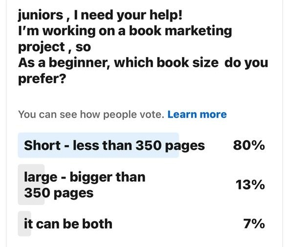

# 📚 Book Sales Analysis: Packt Free-Learning Catalog

## Overview
I scraped the Packt Free-Learning catalog, cleaned the data, and analyzed it to find out what kind of content would help increase engagement and sales among beginner readers.

**Business question:** Is the free catalog aligned with what beginners actually want to read, and how can Packt turn free readers into paying customers?

**Tools:** Python · Requests · BeautifulSoup · Pandas · NumPy · Matplotlib · Seaborn · Jupyter Notebook

**What I did:**
- **Collected** 31 titles (title, page count, release date, author) by scraping packtpub.com/free-learning
- **Cleaned** the data: extracted numeric page counts and filled 4 missing values with the mean (527 pages), converted text dates to datetime, normalized author names, and labeled each book as small (≤350 pages) or large (>350 pages)
- **Analyzed** book size, release trends, and reader preferences, then turned the results into a recommendation

## Key Findings
- **The catalog is skewed toward large books:** 27 of 31 titles (87%) are over 350 pages, versus only 4 small ones. That is 575% more large books than small books.
- **Beginners prefer short books:** In a LinkedIn poll of junior developers, 80% preferred books under 350 pages, 13% preferred large books, and 7% had no preference.
- **Release volume is uneven:** 2019 was the strongest year for free-title releases, and output has not grown steadily since.

## Business Recommendations
1. **Increase the share of short, beginner-friendly titles** in the free-learning catalog. Quick wins build a sense of accomplishment and keep readers coming back.
2. **Use short free books as a funnel:** readers who finish a short book are more likely to move on to paid titles, while an overload of large books risks losing beginners before they engage.
3. **Track release year against engagement** going forward, and time new small-book releases around historically strong periods.

## Visual Preview

*LinkedIn poll: 80% of junior developers prefer books under 350 pages.*
